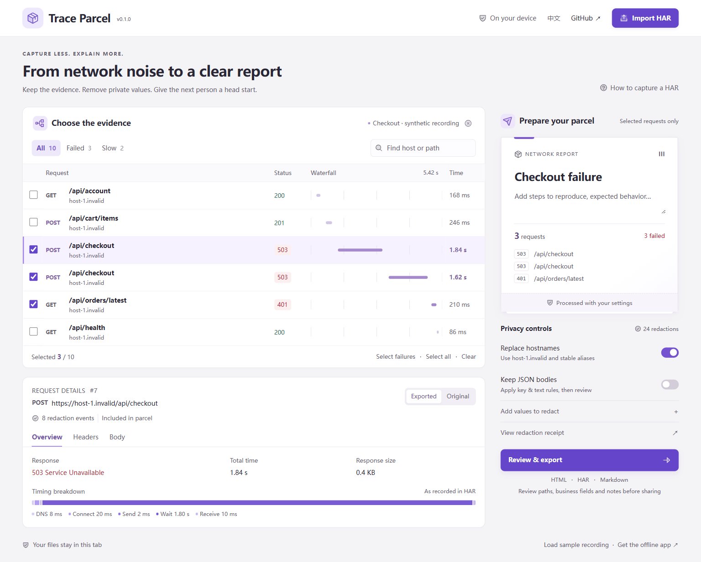

# Trace Parcel

**Turn a HAR recording into a bug report someone can act on**

Keep the requests behind a failed checkout, remove private values, and send one readable file. Trace Parcel runs in your browser or terminal, entirely on your machine.

[Open the workspace →](https://chenpingan-dev.github.io/trace-parcel/) · [Download the offline app](https://github.com/chenpingan-dev/trace-parcel/releases/latest) · [简体中文](README.zh-CN.md)



## From a recording to a handoff

1. **Import a HAR** exported from your browser's Network panel
2. **Choose the evidence** using failure and slow-request filters, search and individual selections
3. **Review what will leave your machine** with processed/original views, optional JSON bodies and custom literal rules
4. **Export a parcel** as a self-contained HTML report, a reduced HAR, or a Markdown issue summary

The workspace opens with an invented checkout incident: two `503` responses and an expired session. No real traffic, accounts or services are involved.

## What you get

| Output | Use it for |
| --- | --- |
| HTML report | Share readable request details, timings and a field-level redaction receipt; open without installing anything |
| HAR | Continue investigating only the selected requests in another HAR tool |
| Markdown | Paste a compact request table and processing policy into an issue |

- Request waterfall, recorded timings, response status and size
- Stable hostname aliases across selection changes
- Preview and download generated from the same processed snapshot
- An explicit local-only original view; it is never embedded in the exported report
- 中文 / English, keyboard-operable controls and a responsive layout
- A single offline workspace file, with no external fonts, analytics, runtime services or API keys
- Browser and CLI share the same TypeScript processing engine

## Processing defaults

By default, exports replace hostnames and query values, remove cookies and header values (except known Content-Type media types), and omit all request/response bodies. IP addresses, original dates, page titles, comments and browser-specific extension fields are discarded. Relative timing is preserved against a synthetic date.

**Keep JSON bodies** is opt-in. It applies sensitive-key rules, email/Bearer/JWT text patterns and your literal rules to parseable JSON. Form data, base64, non-JSON, malformed, excessively nested and oversized bodies remain omitted.

Paths, unknown business identifiers and written notes still need review. This is a deterministic rule-based tool, not a universal PII detector or a guarantee that a file is safe to publish. See [the exact processing policy](docs/privacy.md).

## Run locally

Open `trace-parcel-offline.html` from [Releases](https://github.com/chenpingan-dev/trace-parcel/releases/latest), or build from source with Node.js 22+:

```sh
git clone https://github.com/chenpingan-dev/trace-parcel.git
cd trace-parcel
npm ci
npm run build
npm start
```

Open `http://127.0.0.1:4178`. You can also open `dist/index.html` directly without a server.

## Use the CLI

```sh
node dist/cli.mjs capture.har --out report.html --har cleaned.har --markdown issue.md --only-failed
```

Add `--keep-json` to retain processed JSON, `--keep-hosts` to retain domains, or `--lang zh-CN` for a Chinese report. Use `--rules values.local` to read literal values from a UTF-8 file, one per line, instead of putting them in shell history. Existing output files are never overwritten.

The release also includes a standalone `trace-parcel-cli.mjs` with the same options. It requires Node.js 22+ and no installed packages.

## Supported input

HAR 1.2 JSON with HTTP/HTTPS entries, valid start times and response status codes. Up to **20 MiB and 5,000 requests** per recording. The request list displays the first 150 matching rows; export includes every selected request. WebSocket messages and non-HTTP entries are not supported.

## Development

```sh
npm run check
npm test
```

Tests cover export exclusions, JSON rules, encoded paths, host aliases, hostile markup, schema limits, original-file preservation and the offline app's CSP hash. CI checks Node 22/24 on Linux and Windows.

- [`src/core.ts`](src/core.ts): parsing, explicit output schema, processing and report writers
- [`src/app.ts`](src/app.ts): local browser workspace
- [`src/cli.ts`](src/cli.ts): file-based command-line entry
- [`docs/design.md`](docs/design.md): visual and interaction constraints

## Design references

[Hoppscotch](https://github.com/hoppscotch/hoppscotch) informed the request-focused inspection workflow. [Presidio](https://github.com/data-privacy-stack/presidio) informed the explicit detection/processing model. Trace Parcel has its own implementation, scoped to local HAR handoff; neither project is a dependency or affiliated with it. Interface icons are [Phosphor](https://github.com/phosphor-icons/core), with attribution in [THIRD_PARTY.md](THIRD_PARTY.md).

MIT · Independent personal project · AI-assisted development
