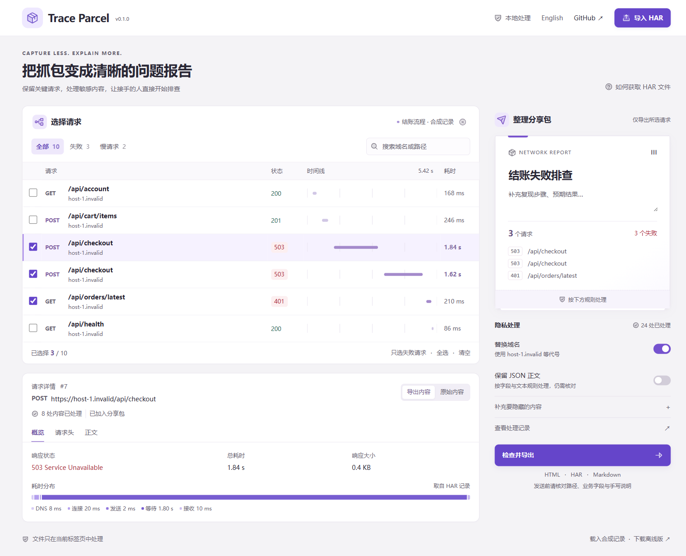

# Trace Parcel

**把抓包变成一份别人能接着排查的问题报告**

留下失败结账背后的关键请求，处理敏感内容，再发出一份清晰的文件。支持浏览器和命令行，全程在你的设备上处理

[打开工作区 →](https://chenpingan-dev.github.io/trace-parcel/) · [下载离线版](https://github.com/chenpingan-dev/trace-parcel/releases/latest) · [English](README.md)



## 从抓包到交接

1. **导入 HAR**：从浏览器开发者工具的网络面板导出记录
2. **选择线索**：按失败、慢请求筛选，搜索域名或路径，勾选需要分享的请求
3. **检查导出内容**：对照处理后的请求与原始内容，按需保留 JSON、补充要隐藏的值
4. **导出文件**：生成可独立打开的 HTML 报告、精简 HAR 或 Markdown 问题摘要

工作区内置一个虚构的结账故障：两次 `503` 响应和一次会话过期。全部是合成数据，没有真实账户、流量或外部服务

## 可以导出什么

| 格式 | 用途 |
| --- | --- |
| HTML | 直接查看请求详情、耗时与字段处理记录，接收者无需安装软件 |
| HAR | 带着筛选后的请求，继续在其他 HAR 工具中分析 |
| Markdown | 将请求表格和处理范围贴进 Issue |

- 请求时间线、状态、大小与 HAR 中记录的耗时
- 稳定的域名代号，切换勾选范围也不会变
- 分享预览与下载使用同一份处理结果
- 原始内容仅供本地查看，不嵌入导出的报告
- 微软雅黑、中英文切换、键盘操作与手机布局
- 单文件离线工作区，无远程字体、统计服务、运行时接口或 API Key
- 浏览器与命令行共用同一套 TypeScript 处理引擎

## 默认如何处理

默认替换域名与查询参数值，移除 Cookie 和请求/响应头值，Content-Type 仅保留已知媒体类型；请求和响应正文默认不保留。IP、原始日期、页面标题、注释和浏览器扩展元数据也会被丢弃，相对耗时保留并使用合成日期

主动开启 **保留 JSON 正文** 后，对可解析 JSON 应用敏感字段规则、邮箱/Bearer/JWT 文本规则和自定义规则。表单、base64、其他类型、无效 JSON、嵌套过深或过大的正文仍然移除

路径、未知业务标识和手写说明仍需检查。这是一套确定性的处理规则，无法识别全部敏感信息，也不保证文件可以直接公开发布。具体范围见 [处理策略](docs/privacy.md)

## 本地使用

从 [Releases](https://github.com/chenpingan-dev/trace-parcel/releases/latest) 下载并打开 `trace-parcel-offline.html`，或者使用 Node.js 22+ 从源码构建：

```sh
git clone https://github.com/chenpingan-dev/trace-parcel.git
cd trace-parcel
npm ci
npm run build
npm start
```

访问 `http://127.0.0.1:4178`，也可以直接打开 `dist/index.html`

## 命令行

```sh
node dist/cli.mjs capture.har --out report.html --har cleaned.har --markdown issue.md --only-failed --lang zh-CN
```

`--keep-json` 保留经过处理的 JSON，`--keep-hosts` 保留域名。使用 `--rules values.local` 从 UTF-8 文件读取自定义内容，每行一项，避免把这些值写进命令历史。已有文件不会被覆盖

发布页还提供独立的 `trace-parcel-cli.mjs`，需要 Node.js 22+，无需安装依赖

## 输入范围

HAR 1.2 JSON，支持 HTTP/HTTPS 请求，需包含有效的开始时间与响应状态。单次最多 **20 MiB、5,000 条请求**。列表显示前 150 条匹配结果，导出包含所有已勾选请求。暂不支持 WebSocket 消息和非 HTTP 条目

## 开发

```sh
npm run check
npm test
```

测试覆盖导出内容排除、JSON 规则、URL 编码、域名代号、恶意标记、输入限制、原文件保护和离线页面 CSP。CI 在 Linux、Windows 的 Node 22/24 上运行

## 参考来源

[Hoppscotch](https://github.com/hoppscotch/hoppscotch) 提供了围绕请求组织查看流程的参考，[Presidio](https://github.com/data-privacy-stack/presidio) 提供了明确区分检测与处理步骤的参考。Trace Parcel 独立实现，聚焦 HAR 排查交接，与这两个项目没有依赖或隶属关系。界面使用 [Phosphor](https://github.com/phosphor-icons/core) 图标，授权信息见 [THIRD_PARTY.md](THIRD_PARTY.md)

MIT · 个人独立项目 · AI 辅助开发
